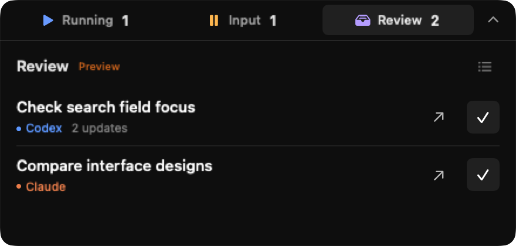

# Task Island

A compact, native macOS status bar for Codex and Claude Code tasks. Keep an eye on work while using other apps, then review finished results in one small queue.



Task Island is an independent, experimental project. It uses local app data and private desktop protocols, so coverage can change when Codex or Claude updates.

## Features

- A 216 × 34 floating bar with Running, Input, and Review counts.
- Hover to expand; move away to collapse. Resting on Running, Input, or Review for a moment switches to it; a click still works.
- Drag the floating panel anywhere; it keeps its top centre as it opens and closes, and centres itself when dropped near the middle of the screen.
- On a Mac with a camera housing (notch), push the panel up into the menu bar over the housing to dock it as an island: Running to the left of the housing, Input and Review to the right, no taller than the menu bar. Drag it off to undock.
- One compact task list: Codex in blue, Claude in orange, with Open and Reviewed actions.
- A durable, task-grouped review queue. Opening a task does not mark it reviewed. Confirming a row acknowledges only the results captured by that action; later results remain pending.
- Quiet, distinct completion and input sounds, with a persistent Sound Effects switch.
- Spring expansion motion that preserves its top edge and respects Reduce Motion.
- Last-observed activity is distinguished from confirmed live activity. A hollow running marker means an observation is awaiting sync, not that the app has verified the task is currently running.

## Coverage

| Source | Available information | Limits |
| --- | --- | --- |
| Codex desktop | Local task catalog, live states for loaded desktop sessions, input requests, and stable completed-result identities | Does not enumerate every host's live tasks. Uses a private observer protocol. |
| Claude Code desktop records | Local runtime registry when present; persisted successful-turn and error identities independent of runtime | Remote/SSH tasks may have completion records without locally observable running/input state. Real-session coverage depends on the desktop version. |
| Claude Remote Control list cache | Timestamped running/input/idle observations; inferred endings when an explicitly active observation is followed by a newer idle observation | Not a continuous live feed. Inferred endings are labeled separately and do not claim a successful upstream turn. |

Ordinary Claude chat and Cowork are not supported. The app does not install hooks or configure remote hosts. A task existing only in a stale remote list cannot be made live by refreshing Task Island's own heartbeat.

## Requirements

- macOS 13 or later.
- Apple Command Line Tools (`xcode-select --install`).
- Node.js 22.19 or later in the Node 22 line (tested baseline).
- Python 3 for the optional installer.

The build targets the host Mac's architecture. The resulting app bundles Node so end users do not need a separate runtime. Builds use a local ad hoc signature and are not notarized.

Node's license is located from the selected installation. For a layout the build
does not recognize, set `NODE_LICENSE_PATH` to that version's complete LICENSE
file. A checked-in license fallback is provided only for Node v22.19.0.

## Build

From the repository root:

```sh
npm ci --prefix monitor-probe/runtime --ignore-scripts --no-audit --no-fund
sh task-island/release.sh
```

This runs the checks, builds `task-island/Task Island.app`, and executes its self-check. It does not install or start monitoring.

To install or update after those checks:

```sh
sh task-island/release.sh --install
```

The installed location is `~/Applications/Task Island.app`. The app has a floating panel and menu-bar item instead of a conventional main window. It does not add a login item.

After a successful build, `python3 task-island/update-installed.py --no-launch`
installs without starting monitoring. Existing app bundles are kept in the
ignored `task-island/backups/` directory. Review data is stored separately and
is not changed by the installer.

## Development checks

```sh
node monitor-probe/runtime/node_modules/typescript/bin/tsc --noEmit -p task-island/tsconfig.json
node task-island/test.mjs
sh task-island/test-review-cases.sh
sh task-island/test-group-review-cases.sh
sh task-island/test-quiet-ui-cases.sh
sh task-island/test-attention-events-cases.sh
sh task-island/test-sound-effects-cases.sh
sh task-island/test-hover-expansion-cases.sh
sh task-island/test-panel-motion-cases.sh
```

The tests use synthetic records and temporary resources. Some IPC tests need permission to create local Unix sockets. A model or layout test passing does not establish that a particular real Claude remote session has a working live feed.

For the additional adapted Codex protocol regression suite, run
`node monitor-probe/test.mjs`.

After building, `python3 -m unittest discover -s tests` checks a fresh install,
an update, and unrelated-app protection in temporary directories without
launching the app or touching the normal installation.

Synthetic offscreen previews do not start source observers or play sounds:

```sh
"task-island/Task Island.app/Contents/MacOS/TaskIsland" --render-preview /tmp/task-island-review.png --floating
```

## Privacy and local state

Task Island does not call a model, generate summaries, send prompts, answer approvals, resume tasks, or upload task content. Its source observers communicate with the native UI through a private pipe containing allowlisted task/navigation metadata.

The underlying Codex IPC can send a full snapshot into memory before projection. The Claude cache reader temporarily copies and decodes the selected local cache before filtering it; this can include unrelated cached content in memory. Only allowlisted session metadata leaves the parser. Temporary copies are private and removed after reading. Unsupported formats fail closed.

Own review state is saved with private permissions and atomic replacement under:

```text
~/Library/Application Support/TaskIsland/review-ledger.json
```

It contains task titles, result identities, and explicit review receipts, not answer bodies. The aggregate `runtime-status.json` in the same directory is for diagnostics. Do not include these files, source-app caches, screenshots of real tasks, credentials, or diagnostic dumps in public issues.

## Project layout

```text
task-island/       SwiftUI/AppKit app, status bridge, tests, and build scripts
monitor-probe/     Adapted local source observers and pinned JavaScript dependencies
```

## License and acknowledgments

MIT. The local observer adapters derive from [Monitor](https://github.com/JustinTervala/monitor), copyright 2026 Justin Tervala, pinned originally at `69b148a3b31350a6bb3546d3dabddf659d891e3b`. Its copyright and MIT permission notice are preserved in `monitor-probe/source/LICENSE`.

The app bundles Node.js and Immer with their applicable license notices. See `THIRD_PARTY_NOTICES.md` for the shipped components. This project is not affiliated with OpenAI or Anthropic.
