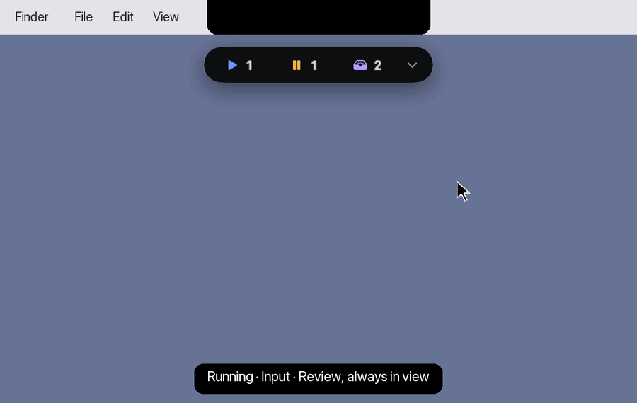

# Monita



A macOS menu-bar app that tracks your **Codex**, **Claude Code**, and **Herdr** coding tasks in one place. See what's running, what needs input, and what's ready to review — without leaving the app you're working in.



Monita shows a small floating bar with three counts: Running, Input, and Review. Hover to expand it into a task list. On a Mac with a notch, push it up into the menu bar to dock it as an island — Running on the left, Input and Review on the right.

Tasks are colour-coded by source: Codex in blue, Claude in orange, Herdr in green. Each has an Open button that takes you to the task in its native app, and a review queue that tracks which results you've seen.

<details>
<summary><b>More features</b></summary>

- Drag the panel anywhere; it stays centred when it opens and closes.
- Completion and input sounds (togglable).
- Spring animation that respects Reduce Motion.
- Herdr tasks are read-only: results clear when you view them in Herdr.

</details>

<details>
<summary><b>Sources and coverage</b></summary>

| Source | What Monita sees | Notes |
| --- | --- | --- |
| Codex desktop | Task catalog, live states, input requests, completed results | Uses a private observer protocol. |
| Claude Code | Local runtime registry; persisted turn and error identities | Remote/SSH tasks may have completion records without live state. |
| Herdr (herdr-core) | Live terminal status across local and remote machines | Read-only. Needs `herdr-core` at `~/.local/bin/herdr-core` (or `MONITA_HERDR_CORE`). A Claude session in a Herdr terminal is listed once, as Herdr. |
| Claude Remote Control | Running/input/idle observations from the list cache | Not a live feed; endings are inferred from newer idle observations. |

Herdr is optional — if herdr-core isn't installed or running, the other sources work normally.

</details>

<details>
<summary><b>Requirements</b></summary>

- macOS 13+
- Apple Command Line Tools (`xcode-select --install`)
- Node.js 22.19+ (bundled into the app at build time)
- Python 3 (for the installer)
- Herdr (optional): `herdr-core` at `~/.local/bin/herdr-core` or set `MONITA_HERDR_CORE`

The build targets the host architecture. The resulting app is ad-hoc signed, not notarized.

</details>

<details>
<summary><b>Build and install</b></summary>

```sh
npm ci --prefix monitor-probe/runtime --ignore-scripts --no-audit --no-fund
sh task-island/release.sh
```

This builds `task-island/Monita.app` and runs checks. To install to `~/Applications`:

```sh
sh task-island/release.sh --install
```

The icon source is `task-island/assets/AppIcon.svg`. After editing it, export a 1024px PNG to `AppIcon.png` — the build generates all icon sizes from it.

</details>

<details>
<summary><b>Development checks</b></summary>

```sh
node monitor-probe/runtime/node_modules/typescript/bin/tsc --noEmit -p task-island/tsconfig.json
node task-island/test.mjs
sh task-island/test-review-cases.sh
sh task-island/test-group-review-cases.sh
sh task-island/test-quiet-ui-cases.sh
sh task-island/test-attention-events-cases.sh
sh task-island/test-sound-effects-cases.sh
sh task-island/test-hover-expansion-cases.sh
sh task-island/test-panel-motion-cases.sh
sh task-island/test-herdr-cases.sh
```

Codex protocol regressions: `node monitor-probe/test.mjs`

Installer tests (doesn't touch the real install): `python3 -m unittest discover -s tests`

Render previews without starting observers: `"task-island/Monita.app/Contents/MacOS/Monita" --render-preview /tmp/preview.png --floating`

Rebuild the demo GIF (needs Pillow): `python3 docs/make-demo.py`

</details>

<details>
<summary><b>Privacy</b></summary>

Monita never calls a model, sends prompts, answers approvals, or uploads task content. It reads local task metadata only.

- **Codex:** communicates through a private pipe; only allowlisted navigation metadata leaves the observer.
- **Claude:** copies and decodes the local cache temporarily, then filters to session metadata. Temporary copies are removed after reading.
- **Herdr:** runs only `herdr-core events --json` and `ls --json`, and only while the core is already running.

Review state is stored at `~/Library/Application Support/TaskIsland/review-ledger.json` (task titles and review receipts, not answer content). Don't include this file, source-app caches, or screenshots of real tasks in issues.

</details>

<details>
<summary><b>Project layout</b></summary>

```text
task-island/       SwiftUI/AppKit app, status bridge, tests, and build scripts
monitor-probe/     Local source observers and pinned JavaScript dependencies
```

</details>

<details>
<summary><b>License</b></summary>

MIT. The local observer adapters derive from [Monitor](https://github.com/JustinTervala/monitor) by Justin Tervala (MIT). The app bundles Node.js and Immer — see `THIRD_PARTY_NOTICES.md`. Not affiliated with OpenAI, Anthropic, or Herdr.

</details>
